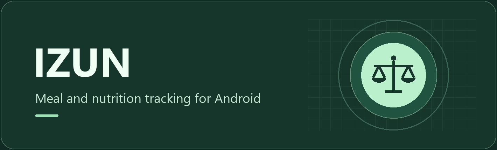
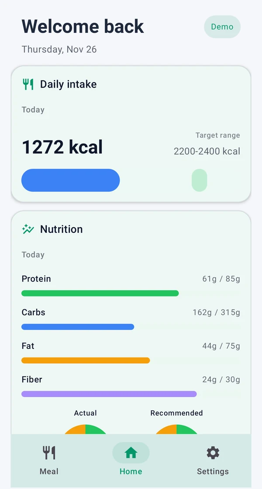
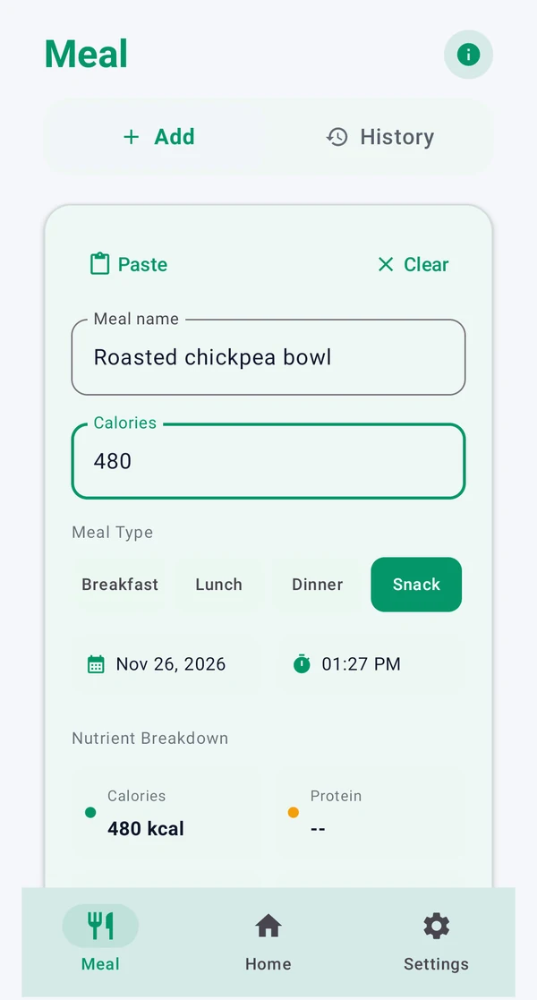
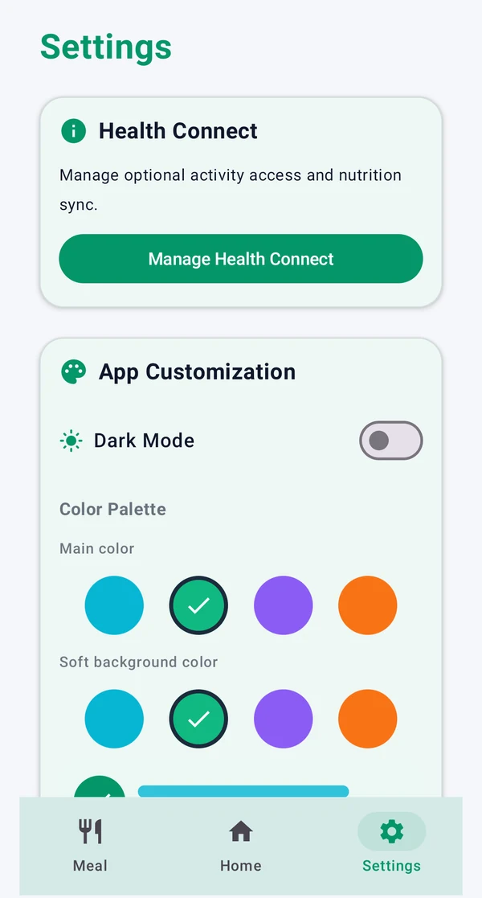

<p align="center">
  
</p>

# IZUN

**Track calories and nutrition on your Android phone.** IZUN keeps your meal log and profile on the device, so you can log food, check your daily totals, and revisit your history offline.

For a quicker entry, ask the AI chat app you already use to estimate a meal from a description, photo, or nutrition label. Paste its **IZUN Report** into the app, review the values, and save. You can use an existing AI subscription with this workflow. IZUN requires no separate AI plan, account, or API key.

## A look inside IZUN

| Daily dashboard | Meal editor | Health Connect |
| :---: | :---: | :---: |
|  |  |  |

The screenshots use fictional meals and a demo profile.

## Log a meal

1. Open **Meal → Add** to enter a meal by hand.
2. For an AI-assisted estimate, copy the prompt from **Settings → Chat Prompt** and use it in your own chatbot. Copy its **IZUN Report**, then tap **Paste** on the meal card.
3. Check the portion, calories, and nutrients before saving. In **History**, you can edit, repeat, or delete saved meals.

<details>
<summary>Try a sample IZUN Report</summary>

```json
{
  "name": "Berry oatmeal",
  "meal_type": "breakfast",
  "start_time": "2026-01-15T08:00:00",
  "end_time": "2026-01-15T08:15:00",
  "energy_kcal": 380,
  "nutrients": {
    "protein_g": 14,
    "total_carbohydrate_g": 56,
    "total_fat_g": 12,
    "dietary_fiber_g": 8
  }
}
```

Set the date to today if you want the sample to appear on today's dashboard.

</details>

## Your data stays on the phone

IZUN stores meals, weight entries, and profile details in app-private storage. It reads clipboard text when you tap **Paste** and saves the parsed meal fields. The app has no analytics or server. Anything you share with a chatbot is handled under that service’s terms.

**Settings → Manage Health Connect** is the place to grant or manage activity and nutrition permissions. You can choose these during the tutorial or skip them. With permission, IZUN can read activity for its dashboard and write confirmed meals to Health Connect. Android backups and device transfers exclude the app's meal database and preferences. Manage any exported nutrition records separately in Health Connect.

## Behind the app

IZUN is built with Kotlin, Jetpack Compose, Material 3, Navigation 3, and Room. It uses a structured JSON import and calculates [nutrition estimates](docs/nutrition-model.md) on the device.

<details>
<summary>Build from source</summary>

The app appears as **IZUN** on Android 8.0 (API 26) and newer. Use JDK 17, SDK Platform 36, and Build Tools 36.0.0. For Android Studio, use a version that supports Android Gradle Plugin 9.3.

```bash
git clone https://github.com/Shlumperon/izun.git
cd izun
./gradlew :app:assembleDebug :app:testDebugUnitTest :app:lintDebug
```

On Windows, use `.\gradlew.bat` in PowerShell. Find the generated APK at `app/build/outputs/apk/debug/app-debug.apk`. With a device connected, run `:app:connectedDebugAndroidTest` for the Android tests.

</details>
